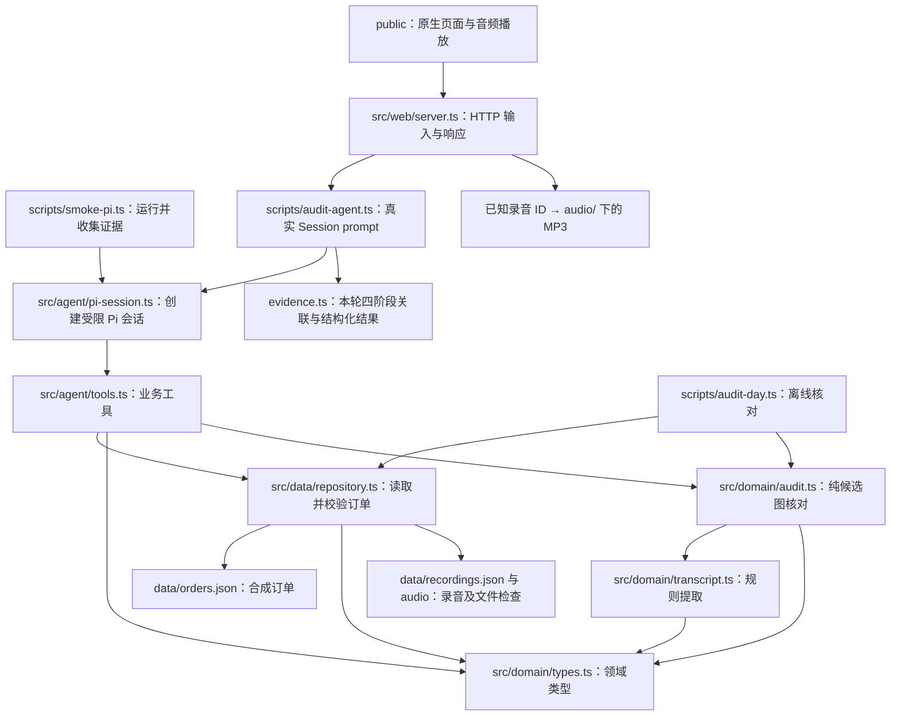

# 技术架构

本项目已建立酒店前台订单与录音核对流程：真实 Pi Runtime、TTS 样本、纯领域核对、审计工具、Express 与原生网页。使用主从核对工作台与独立 AI 报告。全部业务数据均为虚构演示数据。10-15 的可共享证据见[脱敏验收摘要](../evidence/submission/acceptance.md)。

## 当前职责与依赖



依赖方向从 HTTP 编排层流向 Agent、业务工具、数据仓库和领域类型。领域类型没有运行时依赖，数据仓库不导入 agent 模块，各层不形成循环依赖。Web 层调用现有 runAuditAgent，核对规则仍放在领域层；音频路由单独读取录音路径索引并限制为已知 MP3。

所有生产模块禁止读取 `expected_results` 或其他预期答案文件，也不允许跨层读取预置答案来替代查询和核对。离线测试中的断言只存在于测试代码中，不进入 Agent 的上下文或生产查询路径。

| 路径 | 责任 |
| --- | --- |
| `src/domain/types.ts` | 定义订单、录音、核对结果及证据的数据形状。类型与取值约束见 [数据契约](data-contract.md)。 |
| `src/data/repository.ts` | 每次查询重新读取并校验 JSON；订单按办理日、录音按录制日筛选。校验音频路径和普通文件存在性，诊断不可用音频。 |
| `src/domain/transcript.ts` | 纯规则提取房号、房型、日期、金额，保留未知、歧义及原始整句证据。 |
| `src/domain/audit.ts` | 可配置时间窗口、业务身份确认、候选连通分组、五类状态及具体冲突。无文件、网络或 Agent 依赖。 |
| `scripts/audit-day.ts` | 并行读取当天输入，将诊断传给纯引擎，输出结构化 JSON；错误时非零退出。 |
| `src/web/server.ts` | 本机 Express 服务、输入/日期冲突校验、本轮结果筛选、受限 MP3 路由。 |
| `public/` | 原生查询表单、五类统计、候选详情、证据播放与独立 AI 文本；无预置核对答案。 |
| `data/orders.json` | 保存带来源标记的八条合成订单，保留原始 O001。 |
| `src/agent/tools.ts` | 包装日期订单查询与日期核对工具；audit_day 复用仓库和纯引擎，记录实际执行证据。 |
| `src/agent/pi-session.ts` | 接入官方 Pi SDK，选择已注册的 DeepSeek 模型，配置内存认证、设置、会话与资源隔离，并限制工具白名单。 |
| `scripts/smoke-pi.ts` | 启动真实模型会话，发出任务，收集 Runtime 事件和工具执行记录，判定本次运行是否满足验收要求。 |
| `scripts/smoke-checks.ts` | 核验当前 runId 的九项在线条件，拒绝缺失、错配或错误结果。 |
| `src/agent/evidence.ts` | 定义证据记录形状与统一的北京时间戳。 |

数据读取函数为：

```ts
queryOrdersByDate(date: string, ordersFile?: string | URL): Promise<Order[]>
queryRecordingsByDate(date: string, recordingsFile?: string | URL, audioRoot?: string | URL): Promise<RecordingQueryResult>
```

默认文件与音频根目录均按模块位置解析，不依赖启动命令时的当前目录。可选路径或文件 URL 用于离线测试。仓库不缓存内容。录音返回 `{ recordings, warnings }`，只将真实可用文件送入核对；原 `queryOrdersByDate` 行为保持兼容。音频解码校验仍由 Stage 2 数据质量脚本负责。

## Pi Runtime 与工具边界

原 Stage 1 默认模式保留 `tools: ["query_orders_by_date"]`。Stage 4 显式传 `auditEnabled: true`，注册并仅开放 `["query_orders_by_date", "audit_day"]`。会话不提供通用文件读写、Shell、命令执行或联网检索工具。两个模式均使用相同官方 Runtime、内存会话和资源隔离，没有新 Agent Loop。

认证信息通过 `InMemoryCredentialStore` 进入 `ModelRuntime`，设置和会话使用 `SettingsManager.inMemory` 与 `SessionManager.inMemory`。运行时设置 `modelsPath: null`、`refreshOnCreate: false` 与 `allowModelNetwork: false`，避免加载磁盘模型配置或自动发现网络模型；实际模型推理仍需访问所选 DeepSeek 服务。精简的 `ResourceLoader` 显式隔离项目与用户侧的扩展、技能、提示模板和其他可执行资源，避免本机已有的 Pi 配置改变本次验证行为。默认选择内置 `deepseek-flash`，可选已注册的 `deepseek-v4-pro`，并设置 `thinkingLevel: "off"`。生产调用路径必须运行真实 Pi Runtime。

每次在线冒烟验证生成唯一 `runId`。同一工具调用的 Runtime 开始事件、Runtime 结束事件及工具 `execute` 记录，必须用相同的 `runId` 与 `toolCallId` 关联，才能证明模型实际发起了这次工具调用。查询参数与返回订单也必须符合本次验证要求。

直接调用 `execute` 只能说明工具函数可运行；模拟 Runtime 事件只能测试验收逻辑。没有密钥时构建本地会话只能验证工具注册。这些离线行为都不能作为真实模型调用通过的证据。代码不能在工具或冒烟脚本中直接返回预期订单，也不能用预置回答替代模型会话。

原订单查询 smoke 的运行日志写入被 Git 忽略的 `evidence/local/<runId>/`。Stage 1 初轮报告保留在开发归档，不作为精选交付链接；当前共享的网页 audit_day 证据不替代原 query_orders_by_date smoke 的独立验证。缺少密钥时，在线验证先写本次运行的 `BLOCKED` 结果，再以状态码 `2` 退出，不创建会话或发出模型请求。

## 模块接入位置

以下列明各模块接入位置。

| 阶段 | 规划位置 | 接入方式 |
| --- | --- | --- |
| Stage 2（已实现） | `data/recordings.json` 与 `audio/` | 按冻结的 `Recording` 保存八段真实 TTS 音频和服务对齐转写；来源/精度另存元数据。 |
| Stage 3（已实现） | `src/domain/transcript.ts`、`src/domain/audit.ts` | 纯提取与核对，输出继承 `AuditResult` 的 `DetailedAuditResult`，离线 CLI 实际调用。 |
| Stage 4（指定后续运行已在线通过） | 现有业务工具边界 | audit_day 复用仓库和纯核对入口，真实 Session runner 保存结构化结果及四阶段日志。 |
| Stage 5 接入、Stage 6 网页在线验收已完成 | `src/web/server.ts` 与 `public/` | HTTP 调用真实 Agent，页面消费结构化结果并播放真实音频；离线替身仅存在于测试。当前为主从工作台及独立 AI 报告标签。 |
| 集成验证 | `tests/integration/` 与测试夹具 | 覆盖真实数据流与边界；测试数据应明确标记为合成数据。 |

Stage 3 结果可回溯到原录音片段，区分无匹配、字段冲突和信息不足；多候选保留完整集合。标量候选编号不代表复核组已确认配对。具体规则见 [核对规则](audit-rules.md)。生产领域层不读取人工标准答案。

Stage 2 的离线路径为 `generate-demo-data.ts → orders/tts-manifest`，`generate-audio.py → MP3/原始边界/SRT/recordings/audio-metadata`，`validate-demo-data.ts → 真实解码与数据一致性检查`。人工标准答案只由测试读取，生成脚本和正式业务模块都不能加载。场景、来源与可重复运行方式见 [模拟数据说明](demo-data.md)。

Stage 4 的调用链为 `audit-agent → createHotelSession → Pi tool call → audit_day → repository + auditDay → Pi 回答`。Runtime 开始/结束与 execute 开始/结束共用递增 sequence，按 runId/toolCallId/工具名和深度相等的参数、结果关联，只有完整成功调用才进入 `toolResults`。最终模型文字单独保存，不能生成或覆盖业务事实。日志存于新建的 `evidence/local/stage4/<runId>/`，旧目录不变。详见 [Agent 集成说明](agent-integration.md)。

Stage 5 的健康检查不调用模型。审计请求验证选择日期和问题后，调用 runAuditAgent；HTTP PASS 仅使用本轮同日成功工具结果，异常响应不回退到离线算法。网页以 textContent 渲染事实和模型文字，旧输入的响应不能覆盖新查询。音频访问只按已知 recording_id 映射，并验证真实路径仍在 audio/ 根中。见 [Web 接口说明](web-interface.md)。
